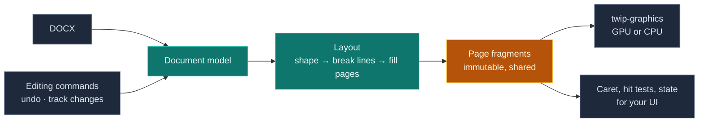

<div align="center">
  <br />
  <br />
  <picture>
    <source media="(prefers-color-scheme: dark)" srcset=".github/Twip-dark.png">
    <source media="(prefers-color-scheme: light)" srcset=".github/Twip.png">
    
  </picture>
  <br />
  <br />

  A high-fidelity document layout, editing, and rendering engine.  
  Written in Rust 🦀. Built for the browser, desktop, and server.

  <a href="https://github.com/jaxcksn/twip/actions/workflows/ci.yml"></a>
  
  <a href="LICENSE"></a>
  <br />
  <a href="https://crates.io/crates/twip"></a>
  <a href="https://www.nuget.org/packages/Twip.Core"></a>
  <a href="https://www.npmjs.com/package/@twip/web"></a>

  <br />

  [**Get started**](#get-started) · [**Explore the engine**](#under-the-hood) · [**Documentation**](#documentation) · [**Roadmap**](jaxcksn.github.io/twip/roadmap)
</div>

<br />

---

### Twip is an engine, not an application.

It isn't trying to be another word processor. Traditional word processors are general-purpose applications. Twip takes a different approach: it provides the underlying document engine, leaving developers free to build experiences tailored to their users, workflows, and industries.

Twip handles the difficult parts of a sophisticated paginated document editor—document structure, precise pagination, text shaping, selection, editing, and rendering—without prescribing the application around them. You bring your own interface, build your own workflows, and own the majority of the experience.

> [!WARNING]
> Twip is in early development. Its API surface is evolving toward a smaller, more extensible, and less opinionated foundation. Application-level concerns such as dialogs, context menus, and tooltips are intentionally being reworked to be less prescriptive. Some of the helpers may remain, but they won't define how your application should behave.

Twip's document model is tied heavily to OOXML and its rich set of document capabilities and compatibility layers. Over time, the model will evolve toward a format-independent representation informed by both OOXML and ODF. The goal isn't to reproduce every feature of Word or LibreOffice. It's to provide a flexible, extensible document foundation capable of supporting complex, specialized use cases without inheriting the constraints of any particular word processor.

<br />

<table>
<tr>
<td width="33%" valign="top">

**01 / Fidelity first**

Layout that respects the document: line breaks, tables, floating objects, columns, sections, and page geometry.

</td>
<td width="33%" valign="top">

**02 / Performant by design**

Recompute what changed, reuse what didn't. Pages can become editable while the rest of a long document continues to paginate. Written in Rust for saftey.

</td>
<td width="33%" valign="top">

**03 / Hybrid Rendering**

Provides a purpose-built hybrid CPU & GPU rendering engine inspired by Vello that works across native graphics backends and the web, with graceful fallbacks.

</td>
</tr>
</table>

## One core. Four ways to build.

| | **Web** | **.NET** | **Swift** | **Rust** |
| :-- | :-- | :-- | :-- | :-- |
| **Package** | [`@twip/web`](https://www.npmjs.com/package/@twip/web) | [`Twip.Core`](https://www.nuget.org/packages/Twip.Core) | `Twip` (Swift package in [`bindings/swift`](bindings/swift)) | [`twip`](https://crates.io/crates/twip) |
| **Runtime** | Browser / Node.js | Windows / Linux | macOS | Native |
| **Integration** | WebAssembly; framework-agnostic | Native AOT-compatible; WinForms control available | async/await; SwiftUI and AppKit editor views | Direct engine API |

The SDKs share the same underlying Rust engine and a common API contract. React and Angular adapters are planned separately; the web SDK does not depend on either framework.

## Built for real documents.

<table>
<tr>
<td width="50%" valign="top">

**Layout & typography**

Paragraph and character styles, complex numbering, tab stops, justification, font fallback, page and section breaks, columns, headers, footers, and notes.

</td>
<td width="50%" valign="top">

**Tables & objects**

Nested and split tables, floating content, inline images, DrawingML and VML shapes, text boxes, wrapping, and on-canvas manipulation.

</td>
</tr>
<tr>
<td valign="top">

**Editing & review**

Commands, selection, caret navigation, undo/redo, find and replace, comments, tracked changes, spelling, and AutoCorrect.

</td>
<td valign="top">

**Templates & automation**

Merge fields, content controls, XML data binding, reusable building blocks, and headless document generation.

</td>
</tr>
<tr>
<td valign="top">

**Rendering & export**

Ships a hybrid 2D rendering engine purpose-built for documents that can render with WebGPU, WebGL 2, and native graphics backends; and provides DOCX save and PDF export.

</td>
<td valign="top">

**Your UI, your rules**

Toolbar state, rulers, context menus, dialogs, and review models exposed for your own frontend, plus an accessibility tree for web editors.

</td>
</tr>
</table>

## Get started

<details open>
<summary><strong>Web · TypeScript</strong></summary>

<br />

```bash
pnpm add @twip/web
```

```ts
import { Editor } from '@twip/web';

const response = await fetch('/report.docx');

const editor = await Editor.mount(document.querySelector('#editor')!, {
  document: new Uint8Array(await response.arrayBuffer()),
  author: { name: 'Ada Lovelace', initials: 'AL' },
  zoom: 'pageWidth',
});

editor.focus();
await editor.commands.selectAll();
await editor.commands.setBold(true);

const { bytes } = await editor.export({ format: 'docx' });
```

</details>

<details>
<summary><strong>.NET · C#</strong></summary>

<br />

```bash
dotnet add package Twip.Core
```

```csharp
using Twip;

await using var session = new EditorSession(
    new EditorSessionOptions(Author: new Author("Report bot")));

await session.OpenAsync("template.docx");
await session.Commands.MoveSelectionAsync(MoveUnit.Document, Direction.Forward);
await session.Commands.InsertTextAsync("Generated by Twip.");

await session.SaveAsync("report.docx");
await session.ExportPdfAsync("report.pdf");
```

For a mounted WinForms editor, install `Twip.WinForms`.

</details>

<details>
<summary><strong>Swift</strong></summary>

<br />

```swift
.package(path: "path/to/twip/bindings/swift")
```

```swift
import Twip

let session = EditorSession(options: SessionOptions(author: Author(name: "Report bot")))
try await session.open(contentsOf: URL(filePath: "template.docx"))

try await session.run(.moveSelection(by: .document, direction: .forward))
try await session.run(.insertText("Generated by Twip."))

try await session.save(to: URL(filePath: "report.docx"))
try await session.exportPDF(to: URL(filePath: "report.pdf"))
```

In SwiftUI, `DocumentEditor(session: session)` from `TwipUI` is the whole editor.

</details>

<details>
<summary><strong>Rust</strong></summary>

<br />

```toml
[dependencies]
twip = "0.1"
```

```rust
use twip::api::command::Command;
use twip::api::engine::{Engine, SessionOptions};
use twip::api::fonts::FontLibrary;
use twip::api::session::{ExportFormat, ExportOptions};

let mut engine = Engine::new(FontLibrary::system());
let id = engine.create_session(SessionOptions::default());
let session = engine.session(id).expect("session exists");

session.open(&std::fs::read("report.docx")?)?;
session.run(Command::SelectAll)?;
session.run(Command::SetBold(true))?;

let export = session.export(&ExportOptions {
    format: ExportFormat::Docx,
})?;
```

</details>

More complete examples live in [`docs/examples`](docs/examples) and [`crates/twip/examples`](crates/twip/examples).

## Under the hood

Twip reads a DOCX into a document model, lays it out into pages and draws those pages with it's rendering engine (twip-graphics). Editing commands change the model, and the layout follows.




Twip's layout architecture is inspired by Chromium's LayoutNG. The layout is a tree of immutable fragments: pages, boxes, paragraphs and lines. A fragment stores no position of its own. Its parent places it, so a line that moves down the page is the same shared fragment, drawn at a new place.

Each page starts from a break token, the point in the document where the page before it ended. The same token in the same page area gives the same page. After an edit, Twip lays out again from the page before the change and stops when a page's start token matches the old layout. From that page on it reuses the old pages as they are.


Paragraphs the edit didn't touch keep their shaped text and line breaks from the layout caches, so even the pages that are laid out again mostly reuse lines. The renderer records each page once and records again only the pages whose drawing changed. Twip executes synchronously within its core engine and exposes asynchronous APIs at the SDK boundary. This allows extensive use of non-atomic reference counting (`Rc` instead of `Arc`) to avoid sync overhead. Combined with immutable layout fragments, this enables efficient structural sharing, pointer-identity caching, and reuse of previously computed results. There's also some cooperative scheduling involved, but that's a different topic.

<details>
<summary><strong>Repository map</strong></summary>

| Path | Purpose |
| :-- | :-- |
| `crates/twip` | Core engine and `twip::api` |
| `crates/twip-capi` | Native C ABI |
| `crates/twip-wasm` | WebAssembly build |
| `crates/twip-tools` | Developer tooling and fidelity comparisons |
| `bindings/web` | TypeScript SDK |
| `bindings/dotnet` | .NET SDK |
| `bindings/swift` | Swift SDK |
| `packages/*` | Framework adapters |
| `tests/contract` | Cross-SDK contract tests |
| `docs` | Guides, examples, and API references |

</details>

## Documentation

Find SDK setup, editing commands, events, rendering, fonts, shape support, review, templates, and API references at the [doc site](https://jaxcksn.github.io/twip). Run the documentation locally with `pnpm moon run docs:dev`.

Want to contribute? See [CONTRIBUTING](.github/CONTRIBUTING.md). Curious what's next? Follow the [roadmap](https://jaxcksn.github.io/twip/roadmap).

---

<div align="center">
  <sub>Built with Rust, and released under the <a href="LICENSE">Apache License 2.0</a>.<br />© 2026 Jackson Casey</sub>
</div>
