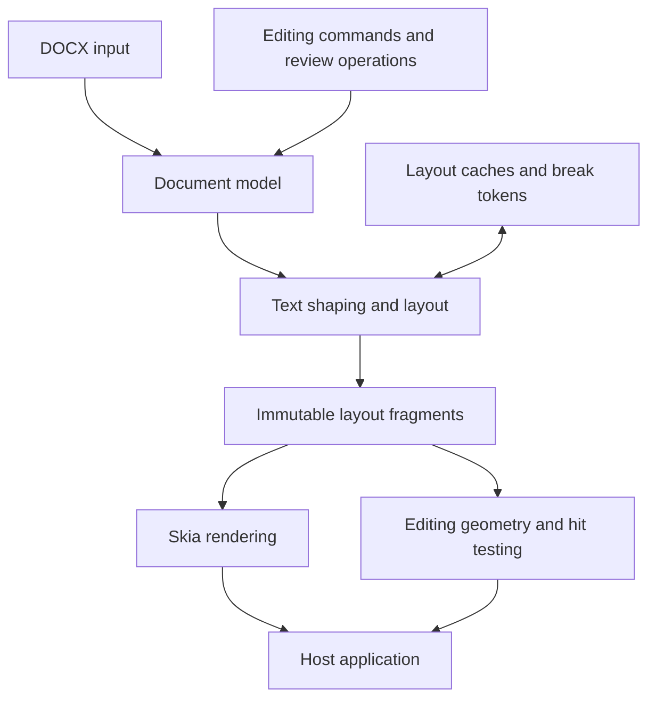
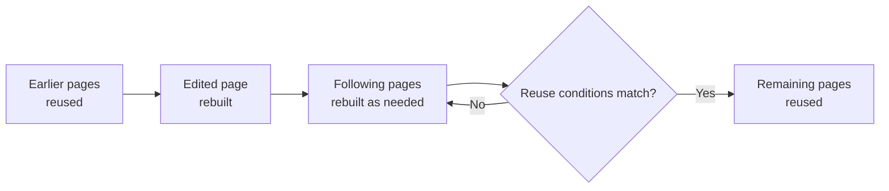
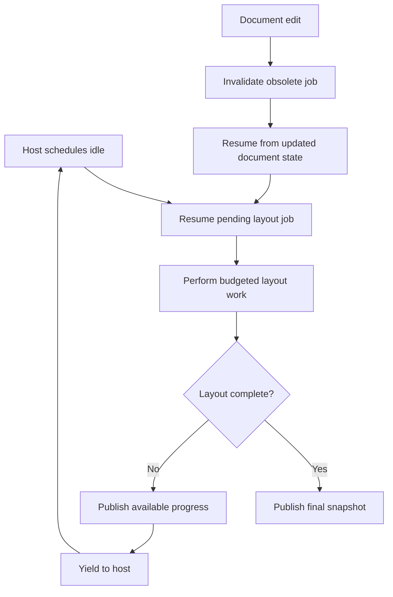

A document engine has an unusual performance constraint: inserting one character can change line wrapping, paragraph height, table placement, footnotes, and page boundaries far beyond the edited position. At the same time, the caret and surrounding content must respond immediately.

Twip's central design principle is **reuse work whose inputs have not changed**. It applies this principle at several levels: document structure, shaped text, line layout, page fragments, recorded drawings, and editing geometry. Local optimizations matter, but the largest savings come from making unnecessary work avoidable in the first place.

This page explains the architecture behind that approach, how the engine schedules work, and where its performance and correctness tradeoffs lie.

## The engine pipeline

The core pipeline separates the logical document from its layout and from the application interface.



Each stage has a distinct responsibility:

| Layer            | Responsibility                                                       |
| ---------------- | -------------------------------------------------------------------- |
| Document model   | Paragraphs, runs, styles, tables, sections, and document semantics   |
| Editing          | Commands, selections, undo/redo, comments, and tracked changes       |
| Text and layout  | Shaping, breaking lines, positioning content, and filling pages      |
| Fragments        | Immutable descriptions of the calculated layout                      |
| Rendering        | Drawing pages using Skia, with recorded output reused where possible |
| Editing geometry | Caret stops, selection geometry, and hit testing                     |
| SDKs             | Exposing the engine to Rust, web, and .NET applications              |

The application owns its interface. Twip provides the document operations and geometric information needed to build that interface, rather than requiring a particular toolbar, framework, or product workflow.

See the [repository overview](https://github.com/jaxcksn/twip#under-the-hood) and [engine API](https://github.com/jaxcksn/twip/blob/main/crates/twip/src/api/engine.rs).

## Fragment-based layout

Twip's layout system takes inspiration from Chromium's **LayoutNG**. Instead of maintaining only a persistent hierarchy of mutable positioned objects, layout produces **immutable fragments** representing its results.

Fragments describe content at different levels, including pages, boxes, paragraphs, and lines. A fragment does not need to store its own absolute position: its parent supplies the placement. The same line can therefore be used in a new location without shaping and breaking its text again.

A simplified representation of this separation looks like:

```rust
// Simplified from layout/fragment.rs
pub struct PlacedLine {
    pub x: f64,
    pub y: f64,
    pub line: Rc<LineFragment>,
}
```

Here, `PlacedLine` stores the position, while the `Rc<LineFragment>` refers to the underlying immutable line result. When an edit moves an otherwise unchanged line, Twip can retain the line fragment and update its placement.

That choice is useful beyond layout. **Stable fragment identity** can also be used to recognize unchanged geometry and to reuse cached representations of a page. Twip uses rather aggressive caching and implements several clever optimizations that takes advantage of it's immutable fragment based layout structure.

### Why not a mutable frame tree?

Traditional document engines such as LibreOffice Writer use a hierarchy of persistent layout frames. Those frames can be invalidated, repositioned, resized, or linked to following frames when content flows across pages. Writer also performs targeted incremental updates; it does not relayout an entire document for every edit.

Twip organizes the problem differently. The primary results of a layout pass are immutable, and the engine decides which previous results can be shared with a newly calculated layout. That makes old results stable while a replacement layout is constructed, but places more responsibility on cache keys, continuation state, and reuse validation.

Neither approach is inherently faster. The advantage of Twip's model is that sharing and reusing completed layout results are fundamental to the representation, rather than separate mechanisms layered onto mutable layout objects.

Further reading: [fragment definitions](https://github.com/jaxcksn/twip/blob/main/crates/twip/src/layout/fragment.rs), [Chromium's layout data structures](https://developer.chrome.com/docs/chromium/renderingng-data-structures), and [LayoutNG fragmentation](https://developer.chrome.com/docs/chromium/renderingng-fragmentation).

## Break tokens and incremental pagination

Pagination is a dependency problem. A line inserted near the beginning of a document may push content onto another page, which can in turn affect subsequent page breaks. Rebuilding every page after each edit would make large documents expensive to edit.

Twip uses **break tokens** to represent the state at which layout stops and can later resume. A page starts with continuation state from the preceding page. After an edit, the engine can restart layout near the changed region, build replacement pages, and look for a point where the new layout safely converges with the old one.



For example, an edit on page 37 of a 200-page document might only require rebuilding pages 37 and 38. If continuation state and the relevant layout conditions match at page 39, later pages can be reused. This is an illustration of possible convergence, not a guarantee for every edit.

## Cooperative background pagination

Long documents may require more pagination work than should be performed in one interactive operation. Twip represents ongoing layout as a resumable job, allowing hosts to advance it in small slices.

The scheduler supports several budget types:

```rust
pub enum Budget {
    Until(Instant),
    Units(u32),
    Pages(u32),
    Unlimited,
}
```

When the host invokes `idle()`, the editor resumes a pending layout job and publishes any progress that is ready. If more work remains, the host schedules another invocation. Web integrations use deferred callbacks for this scheduling; the Rust engine does not need an async runtime.



### The four-millisecond budget

The editing module sets an `IDLE_BUDGET` of **4 ms** for the central background layout run. This limits how much work the layout engine _attempts_ to perform before yielding.

It is **not a hard deadline** for the entire `idle()` call:

- The deadline is evaluated at cooperative work boundaries. One expensive work unit can exceed it.
- Preparatory or follow-up work, including expansion and page synchronization, occurs outside the budgeted layout run.
- Some composition and publication paths can use unlimited work budgets.
- Operations that need a particular page immediately can drive pagination directly rather than waiting for idle slices.

The meaningful responsiveness metric is therefore **actual uninterrupted execution time**, not just the configured layout budget.

### Cancellation and provisional layout

When the document changes, Twip discards its obsolete pending pagination job and records the edit so the next job can resume from an appropriate point. Because the engine's mutable editing state is single-thread-owned, an old layout task is not concurrently publishing changes while a new edit mutates the model.

The engine can also publish partial layout snapshots: completed pages become available while later pages remain unfinished or provisional. Applications can use that progress rather than waiting for the entire document to paginate before displaying or editing its completed regions.

Cancellation operates **between synchronous work units**, not in the middle of a function call. A particularly expensive unit may still delay the next command.

Sources: [`editing/mod.rs`](https://github.com/jaxcksn/twip/blob/main/crates/twip/src/editing/mod.rs), [`layout/job.rs`](https://github.com/jaxcksn/twip/blob/main/crates/twip/src/layout/job.rs), [`layout/incremental.rs`](https://github.com/jaxcksn/twip/blob/main/crates/twip/src/layout/incremental.rs), and [`api/session/host.rs`](https://github.com/jaxcksn/twip/blob/main/crates/twip/src/api/session/host.rs).

## Correctness and performance tradeoffs

The layout architecture deliberately concentrates some complexity in mechanisms that establish whether previous results remain reusable.

| Mechanism                      | Benefit                                        | What must remain correct                              |
| ------------------------------ | ---------------------------------------------- | ----------------------------------------------------- |
| Immutable fragments            | Share layout results between snapshots         | Placement and ownership of shared data                |
| Break tokens                   | Resume layout and identify convergence         | All pagination-dependent state                        |
| Layout caches                  | Avoid repeated shaping and measurement         | Cache-key completeness and collision handling         |
| Pointer-identity geometry memo | Reuse caret stops for unchanged lines          | Pinned allocation lifetime and nonlocal dependencies  |
| `Rc` ownership                 | Non-atomic sharing within one thread           | Avoiding cycles and unintended retention              |
| Cooperative layout             | Progressively paginate without a Rust executor | Work-unit size, scheduling fairness, and tail latency |

Several questions are worth testing explicitly:

- **Tail latency:** what are p95, p99, and maximum input-to-commit times, especially while pagination is active?
- **End-to-end responsiveness:** how long from input to the new frame actually appearing on screen?
- **Large dependencies:** what happens when a table, field, or section change affects many later pages?
- **Multiple sessions:** how fairly does a shared worker schedule several documents with pending pagination?
- **Memory retention:** do discarded snapshots, page records, and cache generations release their references as expected?
- **Equivalence:** does incremental layout produce the same result as a fresh full layout?

The last check is especially important. Optimizations that exploit unchanged state should be tested against a reference path that recomputes the answer.

Twip includes profiling hooks, layout reuse counters, and test-only cache verification paths to support this kind of investigation. See [contributor and profiling guidance](https://github.com/jaxcksn/twip/blob/main/CONTRIBUTING.md).

## Boundaries of the design

A fragment-based engine cannot make every document operation local. DOCX compatibility introduces dependencies involving font metrics, fields, numbering, floating objects, sections, and historic layout behavior. Some edits legitimately force substantial downstream relayout, regardless of the caching strategy.

The current document model is also influenced heavily by OOXML. As the model evolves toward broader format independence, layout and serialization still need to preserve the semantics required by supported documents.

Similarly, the single-thread-owned editing model is not intended to maximize multicore use _within one document_. Independent operations, such as separate document conversions, can be parallelized at a higher level without introducing concurrent mutation into an individual editor session.

The goal is not zero recomputation or a fixed per-keystroke time. It is to keep **ordinary interactive edits local, predictable, and inexpensive whenever the document's dependencies permit it**.
